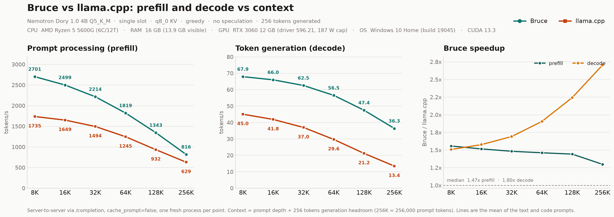

<p align="center">
  
</p>

# Bruce

**A from-scratch CUDA inference engine for [NVIDIA Nemotron Labs Dory 1.0 4B](https://huggingface.co/nvidia/NVIDIA-Nemotron-Labs-Dory1.0-4B-GGUF), written to be faster than llama.cpp on a single RTX 3060.**

No ggml, no PyTorch: Bruce reads the GGUF file itself and runs the model with hand-written kernels built for this architecture and this GPU. The whole engine is one ~9k-line `bruce.cu` plus a small OpenAI-compatible server.

On a 12 GB RTX 3060 it is **1.3x–1.6x faster at prompt processing** and **1.5x–2.7x faster at token generation** than llama.cpp across 8K–256K context, on the same model, same KV cache type, same greedy sampling, same machine.



---

## Benchmarks vs llama.cpp

Both engines served the **same Q5_K_M GGUF** over HTTP, with q8_0 KV cache, 2 loops / `last_loop`, flash attention, greedy sampling, no speculation, no prefix cache, and a fresh server process per context point. Numbers are the mean of a text prompt (Wikipedia articles) and a code prompt (llama.cpp sources); 256 tokens generated per request.

| Context | Prefill Bruce | Prefill llama.cpp | Speedup | Decode Bruce | Decode llama.cpp | Speedup |
|---:|---:|---:|---:|---:|---:|---:|
| 8K | 2701 tok/s | 1735 tok/s | **1.56x** | 67.9 tok/s | 45.0 tok/s | **1.51x** |
| 16K | 2499 tok/s | 1649 tok/s | **1.52x** | 66.0 tok/s | 41.8 tok/s | **1.58x** |
| 32K | 2214 tok/s | 1494 tok/s | **1.48x** | 62.5 tok/s | 37.0 tok/s | **1.69x** |
| 64K | 1819 tok/s | 1245 tok/s | **1.46x** | 56.5 tok/s | 29.6 tok/s | **1.91x** |
| 128K | 1343 tok/s | 932 tok/s | **1.44x** | 47.4 tok/s | 21.2 tok/s | **2.24x** |
| 256K | 816 tok/s | 629 tok/s | **1.30x** | 36.3 tok/s | 13.4 tok/s | **2.70x** |

The decode lead grows with context, because the longer the conversation the more time both engines spend re-reading the KV cache — and Bruce's cache layout is much cheaper to read.

**Test machine:** Windows 10 · Ryzen 5 5600G · 16 GB RAM · RTX 3060 12 GB (187 W cap) · CUDA 13.3.
**VRAM at 256K context:** Bruce 9.3 GB, llama.cpp 10.2 GB (both fit in 12 GB).

Full protocol, per-prompt tables, raw JSON, server logs, and the runnable harness are in [`benchmarks/`](benchmarks/README.md). An earlier 4K/32K/256K head-to-head with speculation on both engines is in [`bench/`](bench/README.md).

---

## Why it's fast, in plain English

**1. It does its own math.** llama.cpp is a general engine that has to support hundreds of model shapes. Bruce supports exactly one model, so every kernel can assume the exact tensor sizes, quantization mix, attention pattern, and GPU. Nothing is generic, nothing is left for the compiler to figure out.

**2. The model stays compressed the whole time.** The 4B model is stored at ~5 bits per weight, and Bruce never blows it up to 16-bit. It unpacks small pieces on the fly inside the GPU and does the multiply-accumulate as 8-bit integer dot products, which this GPU does four at a time per instruction. Decoding a token means streaming ~3.4 GB, so reading fewer bytes is the whole game.

**3. The KV cache is laid out so each read is one clean load.** Bruce stores the attention cache as 8-bit numbers with the per-block scales grouped at the front, so a warp fetches 8 values with one 64-bit load instead of eight separate byte loads. Same bytes, same math, **~1.5x faster long-context decode** — purely because the GPU stops waiting on scattered memory.

**4. A whole token is one click, not 700 clicks.** Each decoded token normally means the CPU launching hundreds of small GPU kernels. Bruce records the entire token into a CUDA graph and replays it as a single launch, with the position counter living on the GPU. The CPU stops being the bottleneck.

**5. The model runs its stack twice — so Bruce only reads the cache once.** Dory is a *looped* transformer: the same blocks are applied twice per token. In the second pass, five attention blocks can reuse the first pass's attention output instead of streaming the same KV cache again. Free work, skipped.

**6. It guesses the next few tokens and checks them in one pass.** The optional prompt-lookup drafter proposes up to 7 tokens taken from earlier in the text (great for code, lists, and repetition), then the model verifies all of them in a single weight pass. Verification rows are nearly free because the expensive part — reading the weights — is shared. This takes repetitive code from ~70 to ~95+ tok/s.

**7. Prompt processing uses the tensor cores properly.** A long prompt is a big matrix multiply. Bruce repacks the 5-bit weights once at load time into a form the GPU's 8-bit tensor cores can eat directly, then runs a 128×128 tile — several times faster than a straightforward dequantize-then-multiply kernel.

**8. Concurrent requests share one weight read.** The server batches queued requests into one forward pass. On the test card, 8 simultaneous requests reach **341 tok/s aggregate** (45–56 tok/s each) versus 67 tok/s for one request, because everyone shares the same 14 ms weight stream.

There is also an optional **adaptive loop skip**: when the second pass of the looped block has converged, Bruce skips it. On code it is token-identical; on free-form prose it is a lossy speed mode.

The long, profiler-driven version of all of this — every failed experiment, measured kernel time, and SASS-level detail — is in [`docs/ENGINEERING.md`](docs/ENGINEERING.md).

---

## How this was built

Bruce was developed almost entirely autonomously by AI agents. **Gemini 4 Argon** and **DeepSeek 4.1 Flash** ran the optimization loop end to end — profiling kernels, writing and rewriting CUDA, benchmarking every change, reverting regressions, and validating output against llama.cpp — with a human setting the direction and reviewing the results. [`docs/ENGINEERING.md`](docs/ENGINEERING.md) is the raw trail of that process, including the ideas that did not work.

---

## Getting started

### Requirements

- NVIDIA GPU with ≥ 12 GB VRAM (developed and tuned on an RTX 3060, `sm_86`)
- CUDA Toolkit 13.x (`nvcc`)
- Windows 10/11 + MSVC Build Tools (the platform used for all published numbers) **or** Linux + a recent C++ toolchain (`engine/build.sh`). Linux should work, but has not been tested yet — see [Limitations](#limitations).
- ~4 GB disk for the model, ~16 GB system RAM

### 1. Get the model

```bat
hf download nvidia/NVIDIA-Nemotron-Labs-Dory1.0-4B-GGUF ^
  NVIDIA-Nemotron-Labs-Dory1.0-4B-Q5_K_M.gguf --local-dir models
```

(or download `NVIDIA-Nemotron-Labs-Dory1.0-4B-Q5_K_M.gguf` from the Hugging Face page by hand)

### 2. Build

```bat
engine\build.cmd
```

This calls `vcvars64.bat`, compiles `engine/src/bruce.cu` with `-O3 -arch=sm_86`, and writes `engine/bruce.exe`. If Visual Studio lives somewhere else, edit the `vcvars64.bat` path at the top of the script. The `sm_86` target is hardcoded in `build.cmd`; change it for a different GPU.

On Linux:

```bash
cd engine
./build.sh                  # sm_86 (RTX 3060)
CUDA_ARCH=sm_89 ./build.sh  # RTX 40-series, etc.
```

The Linux path uses `pread` for GGUF streaming and POSIX sockets. It is expected to work out of the box, but no Linux run is included in the published numbers yet.

### 3. Run

```bat
engine\bruce.exe --model models\NVIDIA-Nemotron-Labs-Dory1.0-4B-Q5_K_M.gguf ^
  --ctx 32768 --prompt-text "Write a haiku about GPUs." --chat --text --gen 128 --greedy
```

If you omit `--model`, Bruce uses `%BRUCE_GGUF%`, or the model filename in the current directory. On Linux use `./engine/bruce` and `/` path separators.

Useful flags:

| Flag | What it does |
|---|---|
| `--ctx N` | context capacity (default 262144) |
| `--gen N` | tokens to generate |
| `--greedy` / `--temp T --top-p P` | sampling |
| `--draft 7` | prompt-lookup speculative decoding |
| `--adaptive-loops` | skip the second loop when it has converged (lossy on prose) |
| `--bench N --bench-at POS` | pure decode benchmark at a context depth |
| `--serve` | start the OpenAI-compatible HTTP server |

### 4. Serve it

```bat
engine\bruce.exe --model models\NVIDIA-Nemotron-Labs-Dory1.0-4B-Q5_K_M.gguf ^
  --serve --host 127.0.0.1 --port 8080 --ctx 32768 --slots 4
```

```bash
curl -s http://127.0.0.1:8080/v1/chat/completions \
  -H "Content-Type: application/json" \
  -d '{"model":"bruce","messages":[{"role":"user","content":"Explain CUDA graphs in one paragraph."}]}'
```

The server speaks `/v1/chat/completions`, `/v1/completions`, `/v1/models`, `/health`, streaming SSE, tool calls, and prefix caching. `--slots N` serves N requests concurrently, each with its own KV slice. `--api-key KEY` turns on bearer-token auth.

---

## Repository layout

| Path | Contents |
|---|---|
| `engine/src/bruce.cu` | the engine: GGUF loader, kernels, sampler, CUDA graphs, CLI |
| `engine/src/*.h` | tokenizer, chat template, HTTP server, sessions, JSON |
| `benchmarks/` | long-context (8K–256K) head-to-head harness, results, chart |
| `bench/` | first 4K/32K/256K head-to-head, speculation and multi-slot tests |
| `tools/` | kernel microbenchmarks, oracle dumper, GGUF inspection, validation scripts |
| `docs/` | engineering log (the long version) and design/optimization notes |

Model weights and build outputs are not committed; see [`.gitignore`](.gitignore).

---

## Correctness

Bruce is validated against llama.cpp's Dory implementation (`brianchmielNV/llama.cpp`, commit `57b70d0`) rather than against itself:

- token-for-token greedy agreement on code prompts, plain and speculative;
- oracle comparisons of per-block activations and full logit vectors at multiple context depths;
- prompt-prefill comparison: same argmax, top-5 5/5, top-50 49/50;
- kernel-level checks against CPU references (Q5_K GEMM max |diff| ~7e-5, Q6_K ~1e-6);
- bit-identical single-token decode retained as a regression gate.

Some fast paths are deliberately approximate where llama.cpp's flash attention is also approximate; near-tied logits can flip. The engineering log documents which path is exact and which is not.

To reproduce the reference comparison you need the pinned llama.cpp checkout; see [`docs/DEVELOPMENT.md`](docs/DEVELOPMENT.md).

---

## Limitations

- Tuned for one model, one quantization, one GPU family. It is not a general GGUF runner.
- Windows 10/11 is the platform used for every published measurement. Linux is supported in the source and build script and should work, but it has not been tested on real hardware yet.
- Only `sm_86` is built by default; rebuild with `CUDA_ARCH=...` (Linux) or edit `build.cmd` (Windows) for other GPUs.
- `--adaptive-loops` can change sampling on prose.
- Batched (multi-slot) output can diverge from solo output at near-ties, like any batched/verify path.
- No training, no LoRA, no vision, no other architectures (yet).

---

## License

MIT — see [LICENSE](LICENSE). The model weights are NVIDIA's and carry their own license; the llama.cpp reference checkout used for validation is not vendored here.

---

## Support the project

Building this engine meant running a very large number of LLM-driven optimization iterations — profiling, rewriting kernels, benchmarking, and throwing away the regressions. The cost was not only LLM inference: coding agents were also paid to write and rewrite the CUDA kernels. That compute is not free, and it is what made Bruce possible.

If Bruce is useful to you and you would like to see more projects like this, even **$2 can help**. Every contribution goes back into compute for the next engine.

<p align="center">
  <a href="https://ko-fi.com/qbitcorp" target="_blank" rel="noopener">
    
  </a>
</p>
