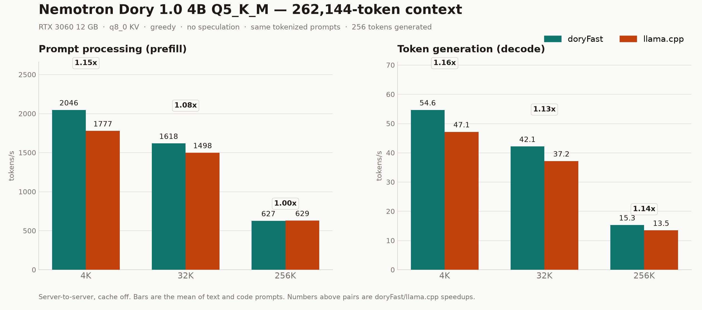

# Nemotron Dory 1.0 4B: Bruce vs llama.cpp at 256K context

> **Naming:** this older sweep called the engine `doryFast`; it is the same code that is
> now `engine/bruce.exe`. The long-context (8K–256K) sweep in
> [`../benchmarks/`](../benchmarks/README.md) is the current reference.
>
> **Update 2026-10-27:** the engine-only breakthrough re-baseline is in
> [`../docs/ENGINEERING.md`](../docs/ENGINEERING.md) §4/§4b (prefill 16K 2341 tok/s,
> 4-row verify round 19.59 ms, speculative code 72.2 tok/s). The head-to-head numbers
> below were measured before that round and use plain M=1 decode, which deliberately kept
> its original kernels; the prefill figures are therefore conservative for the current build.

Measured 2026-10-24 10:32 on the same machine, model, and tokenized prompts.

**Machine:** Windows 10 22H2 (build 19045), AMD Ryzen 5 5600G (6C/12T), 16 GB RAM, NVIDIA RTX 3060 12 GB (driver 596.21, 187 W cap).

**Observed under load:** SM clock 1875-1890 MHz, temperature 61-78 C, board power 117-173 W.

**VRAM at 262,144 context:** doryFast 9631 MiB, llama.cpp 10313 MiB (of 12,288 MiB).



## Setup

| Item | doryFast | llama.cpp |
|---|---|---|
| Engine | `engine/dory.exe` (from-scratch CUDA) | `llama-server.exe` build 1, commit `57b70d0` (Dory PR #30306) |
| Model | `NVIDIA-Nemotron-Labs-Dory1.0-4B-Q5_K_M.gguf` | same file |
| Context | 262,144 tokens | 262,144 tokens |
| Loops / KV mode | 2 loops, `last_loop` | 2 loops, `last_loop` (`--override-kv`) |
| KV cache | q8_0 | q8_0 (`-ctk q8_0 -ctv q8_0`) |
| Attention | flash (engine default) | `-fa on` |
| Prompt batch | 512 | `-b 2048 -ub 1024` |
| Sampling | greedy (`temperature 0`) | greedy |
| Speculation (primary) | off | off |
| Prefix cache | off (`cache_prompt: false`) | off (`cache_prompt: false`) |
| Generation | 256 tokens, `ignore_eos` | same |

Both servers were driven through `POST /completion` with the **same prompt token-id array**, so tokenization and prompt content are identical. One 4K warmup request preceded the measurements. Repeats: 3 at 4K, 2 at 32K, 1 at 256K. Tables report the median of the repeats (single run at 256K).

**Prompts:**
- **Text generation:** 16 long English Wikipedia articles (history, science, geography) followed by: *"Write the next section in the same style: a vivid, carefully paced essay about how ordinary people experienced the fall of the Roman Empire. About 500 words."*
- **Code generation:** concatenated llama.cpp C++/CUDA sources followed by: *"// Task: implement a lock-free single-producer single-consumer ring buffer in modern C++. Provide the complete header and explain the memory-ordering choices."*

### Prefill (prompt processing), tokens/s

| Prompt depth | Text: doryFast | Text: llama.cpp | Text: speedup | Code: doryFast | Code: llama.cpp | Code: speedup |
|---:|---:|---:|---:|---:|---:|---:|
| 4K | 2046.8 | 1776.9 | **1.15x** | 2046.2 | 1777.2 | **1.15x** |
| 32K | 1619.7 | 1498.3 | **1.08x** | 1616.0 | 1498.2 | **1.08x** |
| 256K (256,000) | 626.4 | 629.4 | **1.00x** | 626.8 | 628.8 | **1.00x** |

### Decode (generation), tokens/s

| Prompt depth | Text: doryFast | Text: llama.cpp | Text: speedup | Code: doryFast | Code: llama.cpp | Code: speedup |
|---:|---:|---:|---:|---:|---:|---:|
| 4K | 54.63 | 47.14 | **1.16x** | 54.65 | 47.14 | **1.16x** |
| 32K | 42.18 | 37.19 | **1.13x** | 42.11 | 37.14 | **1.13x** |
| 256K (256,000) | 15.30 | 13.45 | **1.14x** | 15.29 | 13.45 | **1.14x** |

### Time to process the prompt and generate 256 tokens

| Depth | Text prefill d/l (s) | Text decode d/l (s) | Code prefill d/l (s) | Code decode d/l (s) |
|---:|---:|---:|---:|---:|
| 4K | 2.0 / 2.3 | 4.7 / 5.4 | 2.0 / 2.3 | 4.7 / 5.4 |
| 32K | 20.2 / 21.9 | 6.1 / 6.9 | 20.3 / 21.9 | 6.1 / 6.9 |
| 256K (256,000) | 408.7 / 406.7 | 16.7 / 19.0 | 408.4 / 407.2 | 16.7 / 19.0 |

`d/l` = doryFast / llama.cpp, in seconds.

### Summary

Across the six measured prompt/depth points, doryFast's median decode speedup is **1.14x** (range 1.13x-1.16x); prefill speedup is **1.08x** (range 1.00x-1.15x).

At the full 256K depth the practical numbers are: prefill **626.4 vs 629.4 tok/s** and decode **15.30 vs 13.45 tok/s** on text.

The prefill lead is depth-dependent: **1.15x at 4K, 1.08x at 32K, and 1.00x at 256K** (a 0.5% tie). Decode stays ahead by 1.13-1.16x at every depth.

Forcing llama.cpp to the same 512-token compute batch at 32K costs it 3.5% prefill (1446 vs 1498 tok/s), which puts doryFast **1.12x** ahead there; decode is unchanged.

### Batch-size sensitivity: llama.cpp `-ub 512`

llama.cpp normally computes 1024-token prompt batches in the supplied script; doryFast's maximum is 512. This control run uses the same 512-token compute batch for llama.cpp at 32K.

| Prompt | llama.cpp prefill @1024 | @512 | llama.cpp decode @1024 | @512 |
|---|---:|---:|---:|---:|
| Code / 32K | 1498.2 | 1446.6 | 37.14 | 37.62 |
| Text / 32K | 1498.3 | 1446.4 | 37.19 | 37.64 |

## Ngram / prompt-lookup speculation (secondary)

Both engines were also run with their ngram drafter enabled: doryFast `--draft 7 --draft-ngram 4` (defaults) and llama.cpp `--spec-type ngram-simple --spec-ngram-simple-size-n 4 --spec-ngram-simple-size-m 7`. Draft tokens are verified by the target model, so speculation is a speed-only feature.

| Depth | Prompt | doryFast tok/s | llama.cpp tok/s | Speedup | doryFast vs plain | llama.cpp vs plain |
|---:|---|---:|---:|---:|---:|---:|
| 4K | Text | 57.94 | 54.41 | **1.06x** | 1.06x | 1.15x |
| 4K | Code | 56.49 | 51.17 | **1.10x** | 1.03x | 1.09x |
| 32K | Text | 42.90 | 39.52 | **1.09x** | 1.02x | 1.06x |
| 32K | Code | 45.39 | 36.05 | **1.26x** | 1.08x | 0.97x |

Speculation is content-dependent. On these non-repetitive prompts doryFast's drafter adds **2-8%** (1.02x-1.08x), while llama.cpp's ngram path ranges from **-3% to +15%** (0.97x-1.15x); at 32K/code llama.cpp is 3% *slower* than its own plain decode. In absolute terms doryFast stays ahead at all four points (**1.06x-1.26x**). The larger gains in doryFast's README come from repetitive code/list continuations, which these prompts are not.

## Sanity checks

Every measured request processed exactly the requested prompt length, generated exactly 256 tokens, and reported zero prefix-cache reuse.

Run-to-run spread across repeated 4K/32K requests: at most **0.8%** (min-max around the median).

Generated text (first 160 chars, greedy, 4K depth):

- **Text / doryFast:** The fall of the Roman Empire was not a single event but a long, messy process that unfolded over centuries. The empire's decline was driven by a combination of 
- **Text / llama.cpp:** Do not write a summary or bullet points. Do not use the word "first" or "last". Do not use the word "event". Do not use the word "crisis". Do not use the word "
- **Code / doryFast:** ```  The user wants me to complete the implementation of `llama_context.cpp`. The code is cut off at the end of the constructor. I need to continue implementing
- **Code / llama.cpp:** ```  The user wants me to complete the implementation of the llama_context constructor in llama-context.cpp. The code is cut off at "cparams.n_outputs_max = par

## Raw repetitions (plain)

| Engine | Prompt | Depth | Rep | Prefill tok/s | Decode tok/s | Clock MHz | Temp C |
|---|---|---:|---:|---:|---:|---:|---:|
| doryFast | Code | 4K | 1 | 2046.0 | 54.65 | 1890 | 62 |
| doryFast | Code | 4K | 2 | 2046.2 | 54.66 | 1890 | 62 |
| doryFast | Code | 4K | 3 | 2046.5 | 54.64 | 1890 | 62 |
| doryFast | Text | 4K | 1 | 2046.8 | 54.63 | 1890 | 61 |
| doryFast | Text | 4K | 2 | 2046.8 | 54.51 | 1890 | 62 |
| doryFast | Text | 4K | 3 | 2046.6 | 54.64 | 1890 | 62 |
| doryFast | Code | 32K | 1 | 1619.1 | 42.27 | 1890 | 66 |
| doryFast | Code | 32K | 2 | 1612.8 | 41.95 | 1890 | 66 |
| doryFast | Text | 32K | 1 | 1620.0 | 42.08 | 1890 | 64 |
| doryFast | Text | 32K | 2 | 1619.4 | 42.27 | 1890 | 65 |
| doryFast | Code | 256K (256,000) | 1 | 626.8 | 15.29 | 1890 | 71 |
| doryFast | Text | 256K (256,000) | 1 | 626.4 | 15.30 | 1890 | 70 |
| llama.cpp | Code | 4K | 1 | 1771.9 | 47.17 | 1890 | 66 |
| llama.cpp | Code | 4K | 2 | 1777.2 | 47.14 | 1890 | 66 |
| llama.cpp | Code | 4K | 3 | 1777.4 | 47.13 | 1890 | 67 |
| llama.cpp | Text | 4K | 1 | 1775.8 | 47.14 | 1890 | 65 |
| llama.cpp | Text | 4K | 2 | 1776.9 | 47.17 | 1890 | 66 |
| llama.cpp | Text | 4K | 3 | 1777.0 | 47.13 | 1890 | 66 |
| llama.cpp | Code | 32K | 1 | 1498.4 | 37.16 | 1890 | 70 |
| llama.cpp | Code | 32K | 2 | 1498.0 | 37.13 | 1890 | 71 |
| llama.cpp | Text | 32K | 1 | 1498.3 | 37.20 | 1890 | 69 |
| llama.cpp | Text | 32K | 2 | 1498.3 | 37.18 | 1890 | 70 |
| llama.cpp | Code | 256K (256,000) | 1 | 628.8 | 13.45 | 1875 | 78 |
| llama.cpp | Text | 256K (256,000) | 1 | 629.4 | 13.45 | 1875 | 78 |

## Caveats

- This is a server-to-server test. Both figures include each engine's HTTP/sampler loop, so they reflect what an application actually sees.
- Prompt batches differ by design: doryFast 512, llama.cpp 1024 (`run_dory.bat`). Both are the values in the supplied launch scripts. The equal-batch control above shows that this accounts for ~3.5% of llama.cpp's 32K prefill rate; decode is unaffected.
- doryFast's shipped `run_dory_fast.bat` enables `--draft 7`; the supplied `run_dory.bat` does not. The primary table disables speculation on both for a fair engine-to-engine comparison; the speculative table enables it on both. Speculation was measured at 4K/32K only; at 256K the ~7-minute prefill dominates wall-clock time.
- 256K runs use a 256,000-token prompt plus 256 generated tokens (5,888 tokens of headroom in a 262,144-token context). They are single runs; 4K/32K are medians.
- The same GGUF, q8_0 KV, 2 loops/last_loop, flash attention, and greedy sampling are used on both sides. A pre-run tokenizer check produced identical token IDs for the same short text.
- Greedy continuations diverged between the two engines on some prompts (known numerical sensitivity in this model, documented in the doryFast README); throughput is therefore compared on the same prompt and a forced 256-token length, not on identical text.
- Both launch scripts enable reasoning/thinking, so the 256-token window can contain analysis before prose or code. This matches the supplied configurations and does not change the throughput metric.

