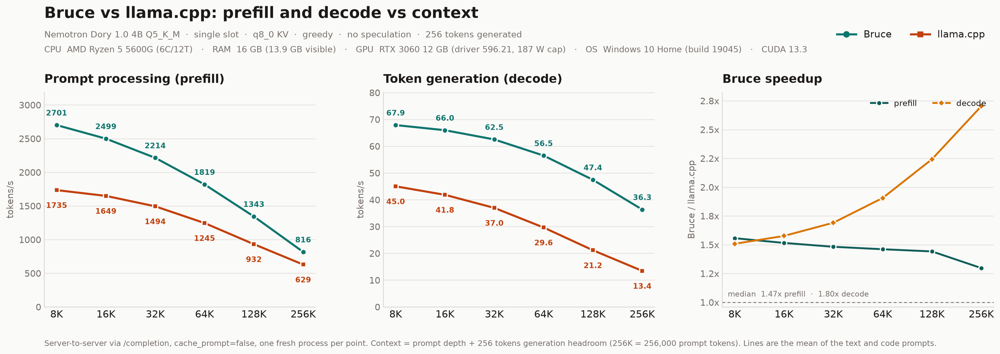

# Bruce vs llama.cpp: long-context benchmark

Single-slot prefill and decode at **8K, 16K, 32K, 64K, 128K, and 256K** prompt depth, on the same GGUF, tokenized prompts, KV type, and GPU. Measured 2026-10-30 00:23:50.

**Machine:** Microsoft Windows 10 Home 10.0.19045  ·  AMD Ryzen 5 5600G (6C/12T)  ·  16 GB RAM (13.9 GB visible)  ·  NVIDIA GeForce RTX 3060 12 GB (driver 596.21, 187 W cap)  ·  CUDA 13.3.



**Headline:** Bruce is **1.30x-1.56x** faster at prefill and **1.51x-2.70x** faster at decode across the measured contexts.

## Protocol

| Item | Bruce | llama.cpp |
|---|---|---|
| Engine | `engine/bruce.exe` | `llama-server.exe` build 1, `57b70d0` |
| Model | Dory 1.0 4B Q5_K_M | same file |
| Context | prompt depth + 256 generation tokens, per point | same |
| Slots | 1 | 1 |
| Loops | 2 | 2 (`--override-kv`) |
| KV | q8_0, `last_loop` | q8_0, `last_loop` |
| Attention | flash default | `-fa on` |
| Prompt batch | 512 | `-b 2048 -ub 1024` |
| Decode | greedy, no speculation, 256 tokens | same |
| Prefix cache | off | off |
| Repeats | 2 at 8K/16K/32K, 1 above | same |

Each context point starts a fresh server process. Requests are `POST /completion` with the same token-id array and `cache_prompt:false`; a short warmup precedes the measured requests. The text prompt is Wikipedia prose plus an essay task; the code prompt is llama.cpp sources plus a ring-buffer task.

Depths are 8,192 / 16,384 / 32,768 / 65,536 / 131,072 / 256,000 prompt tokens; the last point follows the existing head-to-head report's 256K convention.

### Summary (mean of text and code)

| Depth | Prefill Bruce | Prefill llama | Prefill speedup | Decode Bruce | Decode llama | Decode speedup |
|---:|---:|---:|---:|---:|---:|---:|
| 8K | 2700.7 | 1734.8 | **1.56x** | 67.88 | 45.01 | **1.51x** |
| 16K | 2498.9 | 1648.8 | **1.52x** | 65.96 | 41.84 | **1.58x** |
| 32K | 2214.2 | 1494.0 | **1.48x** | 62.51 | 36.96 | **1.69x** |
| 64K | 1819.4 | 1245.4 | **1.46x** | 56.49 | 29.64 | **1.91x** |
| 128K | 1343.2 | 931.6 | **1.44x** | 47.44 | 21.15 | **2.24x** |
| 256K | 816.1 | 629.1 | **1.30x** | 36.35 | 13.45 | **2.70x** |

Across the 6 measured context points, Bruce's median prefill speedup is **1.47x** (range 1.30x-1.56x) and its median decode speedup is **1.80x** (range 1.51x-2.70x).

From 8K to 256K, prefill falls from **2700.7** to **816.1** tok/s on Bruce (30% retained) and from **1734.8** to **629.1** tok/s on llama.cpp (36% retained); decode falls from **67.88** to **36.35** tok/s and from **45.01** to **13.45** tok/s respectively.

At the 256K point the practical numbers are prefill **816.1 vs 629.1** tok/s (**1.30x**) and decode **36.35 vs 13.45** tok/s (**2.70x**).

The decode lead widens with context, from **1.51x** at 8K to **2.70x** at 256K, while the prefill lead narrows over the same range.

The prefill gap is widest at **8K** (**1.56x**) and narrowest at **256K** (**1.30x**); decode stays ahead at every point.

At 256K Bruce's Q5_K prompt prepack is off because it no longer fits beside the KV pool; that shipped `auto` rule is the main reason the prefill lead is smaller at the last point. Prefill and decode are both single-slot, cache-off, no-speculation server numbers.

## Files

| file | contents |
|---|---|
| `report.md` | full report with per-prompt tables, latency, caveats |
| `README_SNIPPET.md` | compact markdown block ready for the root README |
| `summary.csv` | all per-prompt and combined rows |
| `summary.json` | machine-readable medians and metadata |
| `machine.json` | CPU, GPU, driver, CUDA, and RAM of the run |
| `benchmark_context.png` / `.svg` | three-panel trend chart (recommended) |
| `benchmark_context_bars.png` / `.svg` | grouped-bar alternative |
| `raw/results_*.json` | raw requests and GPU state |
| `logs/` | server logs, one per engine and context (generated locally, gitignored) |
| `run_full.log` | console log of the full sweep |
| `run_context_bench.py` | launcher and request loop |
| `run_all.cmd` | run the sweep, analysis, and charts in one step |
| `analyze_context.py` | medians, CSV/JSON, report |
| `make_context_chart.py` | chart generator |

## Reproduce

```bat
benchmarks\run_all.cmd
```

Or step by step:

```bash
python benchmarks/run_context_bench.py --engine both --fresh
python benchmarks/analyze_context.py
python benchmarks/make_context_chart.py
```

On Linux run `benchmarks/run_all.sh` (or the three commands above). The engine
binary is expected at `engine/bruce` there, and `llama-server` is taken from `PATH`
unless `LLAMA_SERVER` is set.

Model and reference paths default to `models/NVIDIA-Nemotron-Labs-Dory1.0-4B-Q5_K_M.gguf`
and `llama-server.exe` on `PATH`; override with the `BRUCE_MODEL` and `LLAMA_SERVER`
environment variables.

`--fresh` archives an earlier `raw/results_*.json` under `raw/archive/`; without it, new measurements are appended.
