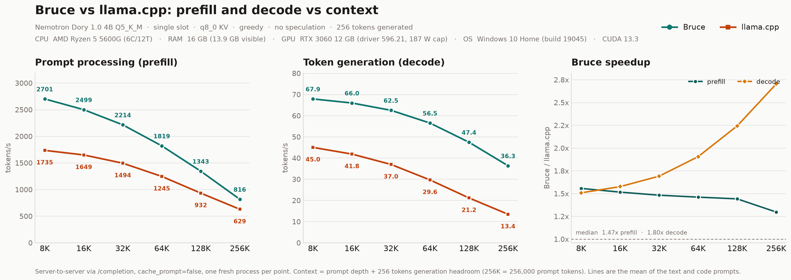

# Bruce vs llama.cpp: prefill and decode vs context

Single-slot server-to-server comparison on the same GGUF, prompt tokens, KV type, and GPU. Measured 2026-10-30 00:23:50.

**Machine:** Microsoft Windows 10 Home 10.0.19045  ·  AMD Ryzen 5 5600G (6C/12T)  ·  16 GB RAM (13.9 GB visible)  ·  NVIDIA GeForce RTX 3060 12 GB (driver 596.21, 187 W cap)  ·  CUDA 13.3.



## Setup

| Item | Bruce | llama.cpp |
|---|---|---|
| Engine | `engine/bruce.exe` | `llama-server.exe` build 1, commit `57b70d0` |
| Model | `NVIDIA-Nemotron-Labs-Dory1.0-4B-Q5_K_M.gguf` | same file |
| Context per point | prompt depth + 256 generation tokens | same |
| Slots | 1 (`--slots 1`) | 1 (`-np 1`) |
| Loops | 2 (`--loops 2`) | 2 (`--override-kv`) |
| KV cache | q8_0, `last_loop` | q8_0, `last_loop` |
| Attention | flash (engine default) | `-fa on` |
| Prompt batch | 512 | `-b 2048 -ub 1024` |
| Sampling | greedy | greedy |
| Speculation | off | off |
| Prefix cache | off (`cache_prompt:false`) | off (`cache_prompt:false`) |
| Generation | 256 tokens, `ignore_eos` | same |
| Repeats | 2 at 8K/16K/32K, 1 above | same |

Both servers were driven through `POST /completion` with the same token-id array. Each context point uses a fresh server process, so no prefix cache or warm KV survives between points. A short warmup request precedes the measurements at each point. Exact per-point command lines are recorded in `raw/results_*.json` under `meta.commands`.

**Text prompt:** 16 long English Wikipedia articles followed by an essay instruction. **Code prompt:** concatenated llama.cpp C++/CUDA sources followed by a ring-buffer task. Depths are 8,192 / 16,384 / 32,768 / 65,536 / 131,072 / 256,000 prompt tokens; the last point follows the existing report's 256K convention.

**Sanity check:** every measured request evaluated exactly the requested prompt length and generated 256/256 tokens on both engines.

**Observed under load:** SM clock 1875-1897 MHz, temperature 58-76 C, board power 124-171 W.

**VRAM at 256K:** Bruce 9,318 MiB, llama.cpp 10,182 MiB of 12,288 MiB.

### Summary (mean of text and code)

| Depth | Prefill Bruce | Prefill llama | Prefill speedup | Decode Bruce | Decode llama | Decode speedup |
|---:|---:|---:|---:|---:|---:|---:|
| 8K | 2700.7 | 1734.8 | **1.56x** | 67.88 | 45.01 | **1.51x** |
| 16K | 2498.9 | 1648.8 | **1.52x** | 65.96 | 41.84 | **1.58x** |
| 32K | 2214.2 | 1494.0 | **1.48x** | 62.51 | 36.96 | **1.69x** |
| 64K | 1819.4 | 1245.4 | **1.46x** | 56.49 | 29.64 | **1.91x** |
| 128K | 1343.2 | 931.6 | **1.44x** | 47.44 | 21.15 | **2.24x** |
| 256K | 816.1 | 629.1 | **1.30x** | 36.35 | 13.45 | **2.70x** |

Across the 6 measured context points, Bruce's median prefill speedup is **1.47x** (range 1.30x-1.56x) and its median decode speedup is **1.80x** (range 1.51x-2.70x).

From 8K to 256K, prefill falls from **2700.7** to **816.1** tok/s on Bruce (30% retained) and from **1734.8** to **629.1** tok/s on llama.cpp (36% retained); decode falls from **67.88** to **36.35** tok/s and from **45.01** to **13.45** tok/s respectively.

At the 256K point the practical numbers are prefill **816.1 vs 629.1** tok/s (**1.30x**) and decode **36.35 vs 13.45** tok/s (**2.70x**).

The decode lead widens with context, from **1.51x** at 8K to **2.70x** at 256K, while the prefill lead narrows over the same range.

The prefill gap is widest at **8K** (**1.56x**) and narrowest at **256K** (**1.30x**); decode stays ahead at every point.

### Prefill (prompt processing)

| Depth | Text Bruce | Text llama | Text speedup | Code Bruce | Code llama | Code speedup |
|---:|---:|---:|---:|---:|---:|---:|
| 8K | 2697.3 | 1718.9 | **1.57x** | 2704.0 | 1750.8 | **1.54x** |
| 16K | 2497.8 | 1637.5 | **1.53x** | 2500.1 | 1660.1 | **1.51x** |
| 32K | 2214.1 | 1490.2 | **1.49x** | 2214.3 | 1497.7 | **1.48x** |
| 64K | 1821.7 | 1243.5 | **1.46x** | 1817.1 | 1247.4 | **1.46x** |
| 128K | 1343.9 | 932.3 | **1.44x** | 1342.5 | 930.9 | **1.44x** |
| 256K | 815.1 | 629.2 | **1.30x** | 817.0 | 628.9 | **1.30x** |

### Decode (token generation)

| Depth | Text Bruce | Text llama | Text speedup | Code Bruce | Code llama | Code speedup |
|---:|---:|---:|---:|---:|---:|---:|
| 8K | 67.86 | 45.00 | **1.51x** | 67.89 | 45.02 | **1.51x** |
| 16K | 65.96 | 41.87 | **1.58x** | 65.96 | 41.81 | **1.58x** |
| 32K | 62.50 | 37.01 | **1.69x** | 62.52 | 36.92 | **1.69x** |
| 64K | 56.47 | 29.64 | **1.91x** | 56.51 | 29.64 | **1.91x** |
| 128K | 47.45 | 21.15 | **2.24x** | 47.43 | 21.15 | **2.24x** |
| 256K | 36.35 | 13.46 | **2.70x** | 36.35 | 13.43 | **2.71x** |

### Prompt and generation time

| Depth | Text prefill d/l (s) | Text decode d/l (s) | Code prefill d/l (s) | Code decode d/l (s) |
|---:|---:|---:|---:|---:|
| 8K | 3.04 / 4.77 | 3.77 / 5.67 | 3.03 / 4.68 | 3.77 / 5.66 |
| 16K | 6.56 / 10.01 | 3.88 / 6.09 | 6.55 / 9.87 | 3.88 / 6.10 |
| 32K | 14.80 / 21.99 | 4.10 / 6.89 | 14.80 / 21.88 | 4.09 / 6.91 |
| 64K | 35.98 / 52.70 | 4.53 / 8.60 | 36.07 / 52.54 | 4.53 / 8.60 |
| 128K | 97.53 / 140.58 | 5.40 / 12.06 | 97.63 / 140.80 | 5.40 / 12.06 |
| 256K | 314.06 / 406.86 | 7.04 / 18.95 | 313.35 / 407.05 | 7.04 / 18.98 |

### Notes and caveats

* This is a server-to-server measurement. Decode tok/s includes each engine's per-token sampler and HTTP loop; Bruce's native CUDA-graph replay (`--bench`) is slightly faster than its server number.
* Context is allocated per point as prompt depth + 256 tokens. The KV pool therefore grows with depth, as it would in a real single-slot deployment; it is not held at 256K for the 8K point.
* Bruce enables its Q5_K prompt prepack when it fits beside the KV cache; with this budget it is on through 128K and off at 256K. That is the shipped `auto` rule, not a benchmark override, and it is the main reason the prefill lead narrows at the 256K point.
* llama.cpp uses its normal 1024-token compute ubatch; Bruce's maximum prefill batch is 512 tokens. This is the same asymmetry as the earlier head-to-head report.
* Both engines generate greedily with `ignore_eos`, so the 256 measured decode tokens are never cut short by EOS.

## Files

| file | contents |
|---|---|
| `summary.csv` | per-prompt and combined rows with both engines and speedups |
| `summary.json` | machine-readable medians and run metadata |
| `machine.json` | CPU, GPU, driver, CUDA, and RAM of the run |
| `benchmark_context.png` / `.svg` | prefill, decode, and speedup vs context |
| `benchmark_context_bars.png` / `.svg` | grouped-bar view of the same data |
| `README_SNIPPET.md` | compact tables and chart block for a README |
| `raw/results_*.json` | raw requests, including GPU state |
| `logs/` | server logs for every context point (generated locally, gitignored) |
| `run_full.log` | console log of the full sweep |
| `run_context_bench.py` | benchmark launcher + request loop |
| `run_all.cmd` | one-step reproduce script |
| `analyze_context.py` | medians, tables, report |
| `make_context_chart.py` | chart generator |

## Reproduce

```bat
benchmarks\run_all.cmd
```

`--fresh` archives an earlier `raw/results_*.json` under `raw/archive/`; without it, new measurements are appended.
